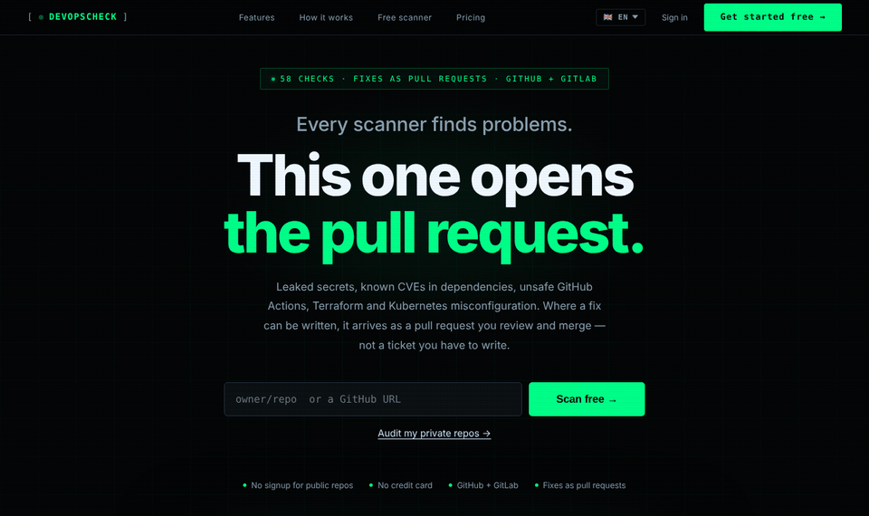
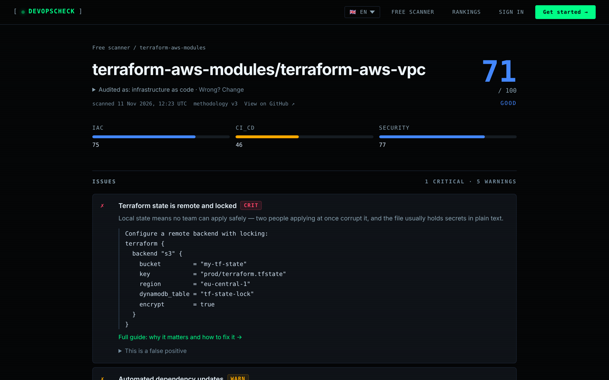
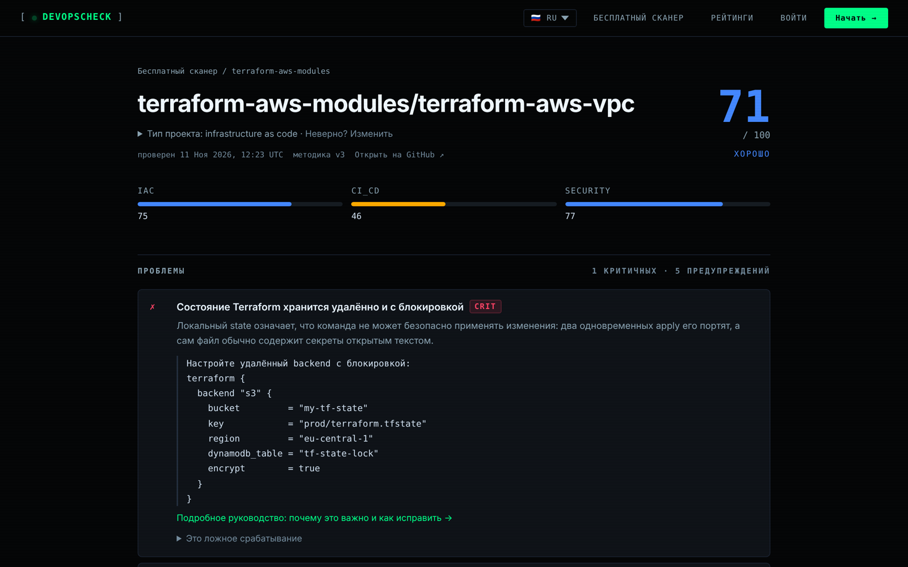
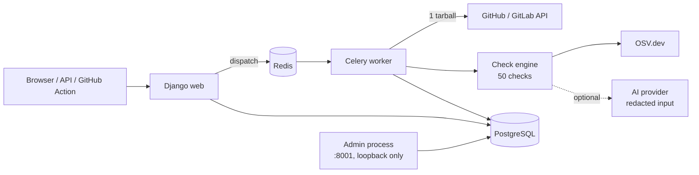

<div align="center">

# 🛡️ DevOpsCheck

**A DevOps & security score for any GitHub or GitLab repository — in seconds.**

Leaked secrets · vulnerable dependencies · CI/CD supply chain · Docker · Kubernetes · Terraform

[](LICENSE.md)
[](https://www.python.org/)
[](https://www.djangoproject.com/)
[](docker/docker-compose.yml)
[](#-contributing)

[Features](#-features) · [Quick start](#-quick-start) · [GitHub Action](#-github-action) · [Configuration](#%EF%B8%8F-configuration) · [Architecture](#-architecture)

<br>



</div>

---

Point DevOpsCheck at a repository and get back a **0–100 score**, a prioritised list of
findings with copy-paste fixes, and — if you want — a pull request that fixes them.
It runs **50 checks** across 8 categories, works with **GitHub and GitLab (including
self-hosted)**, and is fully self-hostable with one `docker compose up`.

```text
 repo ──► one tarball download ──► 50 checks ──► score + findings ──► report / PDF / PR comment / SARIF
          (3 API calls total)        (in memory)    (weighted)          / SBOM / fix pull request
```

## 📸 Screenshots

| Report with copy-paste fixes | Fully translated into Russian |
|---|---|
|  |  |

## ✨ Features

| | |
|---|---|
| 🔑 **Secret scanning** | Full-tree scan with provider-specific patterns and an entropy-gated generic rule. Optional **git-history** scan and **liveness check** — tells you whether a leaked key is still *active*. |
| 📦 **Dependency CVEs** | Known vulnerabilities via [OSV.dev](https://osv.dev), plus lockfile and pinning hygiene. Exports **CycloneDX 1.5** and **SPDX 2.3** SBOMs. |
| ⚙️ **CI/CD supply chain** | Unpinned third-party GitHub Actions, over-broad `permissions`, risky triggers, missing pipelines. |
| 🐳 **Containers & K8s** | Root user, `latest` tags, missing healthchecks, privileged pods, missing resource limits. |
| 🏗️ **Terraform / IaC** | Remote state, `0.0.0.0/0` ingress, unencrypted storage, public buckets, provider pinning. |
| 🤖 **AI agents config** | Checks for repositories that ship AI-agent tooling and instructions. |
| 🧠 **AI summaries (optional)** | Bring your own Anthropic / OpenAI / Gemini key — or none: a built-in rule-based fallback works offline. Everything sent to a model is **redacted** first. |
| 🔧 **Fix pull requests** | One click opens a PR with the fix on a new branch — never on your default branch. An optional agent iterates until CI is green, under strict guardrails (it may never disable a test). |
| ✅ **CI gate** | A GitHub Action that **fails the build** below a threshold or on new findings, and uploads SARIF to *Security → Code scanning*. |
| 📈 **History & trends** | Every run is kept; score history, "what changed since last run", PR comments, weekly digests. |
| 📋 **Compliance mapping** | Each check is mapped to **SOC 2** and **ISO 27001:2022** controls; PDF evidence export. |
| 🌍 **Public scanner** | Scan any public repo at `/scan/<owner>/<repo>/` — no account needed. SVG score badge included. |
| 🌐 **i18n** | English and Russian, 100% translated. |

## 🚀 Quick start

**Requirements:** Docker and Docker Compose v2. Nothing else — Postgres and Redis run in containers.

```bash
git clone https://github.com/<you>/devopscheck.git
cd devopscheck

cp .env.example .env
```

For local development edit `.env` and set at least:

```ini
SECRET_KEY=any-long-random-string
DEBUG=True
ALLOWED_HOSTS=localhost,127.0.0.1
BASE_URL=http://localhost:8000
DB_PASSWORD=devopsaudit
```

Then start everything:

```bash
docker compose -f docker/docker-compose.yml up --build
```

Open **http://localhost:8000** and try the public scanner right away, e.g.
`http://localhost:8000/scan/fastapi/fastapi/`.

Migrations and translations are applied automatically by the entrypoint.

<details>
<summary>👤 Create an admin user and unlock all features</summary>

```bash
docker compose -f docker/docker-compose.yml exec web python manage.py createsuperuser
```

The admin runs as a **separate process** on **http://localhost:8001/admin/** — it is
deliberately not routed on the public site. On your own instance you can grant any
account any plan (Pro / Team / Compliance) from the admin's subscription actions — no
payment provider needed.

</details>

<details>
<summary>🔌 Connect GitHub / GitLab to audit private repositories</summary>

| Provider | How | Env vars |
|---|---|---|
| GitHub OAuth | [Developer settings → OAuth Apps](https://github.com/settings/developers), callback `BASE_URL/accounts/github/login/callback/` | `GITHUB_CLIENT_ID`, `GITHUB_CLIENT_SECRET` |
| GitHub App *(recommended)* | [Developer settings → GitHub Apps](https://github.com/settings/apps) — see comments in `.env.example` for permissions | `GITHUB_APP_*` |
| GitLab | Personal access token in the UI, or an OAuth app | `GITLAB_APP_ID`, `GITLAB_APP_SECRET` |
| Personal token | Paste a PAT on the *Connect* page — no app setup at all | — |

Self-hosted GitLab (custom URL, custom DNS, self-signed TLS) is supported.

</details>

## 🧪 GitHub Action

Gate pull requests on the score. Findings appear in the PR, the job summary and
**Security → Code scanning**.

```yaml
name: DevOpsCheck
on: [pull_request]

permissions:
  contents: read
  pull-requests: write
  security-events: write

jobs:
  devopscheck:
    runs-on: ubuntu-latest
    steps:
      - uses: actions/checkout@v4
      - uses: ./action            # or <you>/devopscheck/action@<sha>
        id: scan
        with:
          api-url: https://your-instance.example.com
          token: ${{ secrets.DEVOPSCHECK_TOKEN }}
          fail-under: 70
      - uses: github/codeql-action/upload-sarif@v3
        if: always() && steps.scan.outputs.sarif-file != ''
        with:
          sarif_file: ${{ steps.scan.outputs.sarif-file }}
```

The action needs only `curl` and `python3`, already present on every runner.
Full reference: [`action/README.md`](action/README.md).

## 📝 `.devopsaudit.yml` — per-repository config

A repository can tune its own audit — without ever being able to fake the score:

```yaml
kind: library            # service | library | infrastructure — overrides auto-detection
fail_under: 70           # the CI gate
ignore:
  - id: docker.nonroot
    reason: the base image already runs as nobody   # a reason is mandatory
severity:
  deps.lockfile: info    # crit | warn | info
allow_secrets:
  - tests/fixtures/      # path prefixes the secret scanner skips
```

Ignored checks stay visible in the report with their reason. The secret checks can't be ignored.

## ⚙️ Configuration

All configuration is read from `.env` ([`.env.example`](.env.example) documents every variable).

| Variable | Required | Purpose |
|---|:---:|---|
| `SECRET_KEY` | ✅ | Django secret key |
| `DB_PASSWORD` | ✅ | Postgres password (used by both Postgres and Django) |
| `ALLOWED_HOSTS`, `BASE_URL` | ✅ | Your host name / public URL |
| `TOKEN_ENCRYPTION_KEY` | prod | Fernet key encrypting stored provider tokens |
| `PUBLIC_SCAN_GITHUB_TOKEN` | prod | Lifts the 60 req/h unauthenticated GitHub limit for the public scanner |
| `ANTHROPIC_API_KEY` / `OPENAI_API_KEY` / `GEMINI_API_KEY` | — | AI summaries; built-in rules are used without them |
| `AUDIT_AI_PROVIDER`, `AUDIT_AI_MODEL` | — | Force a provider / model |
| `EMAIL_*` | — | SMTP for notifications |
| `LEMONSQUEEZY_*`, `CRYPTOMUS_*` | — | Only if you want to sell plans on your instance |
| `SENTRY_DSN` | — | Error tracking |

Each user can also turn off sending anything to an AI provider in their profile — the
product then falls back to local rules.

## 🏗️ Architecture



- **One archive instead of ~90 requests.** `app/repo_client.py` downloads the repository
  as a single tarball and keeps text files in memory — a full audit costs **3 API calls**.
- **Audits are append-only** — one row per run, which powers history and trends.
- **`check_id` is the stable key** (e.g. `security.no_secrets`); display names are translated.
- **Scoring:** critical = 30, warning = 15, info = 5; score = earned / total × 100.

<details>
<summary>📁 Project layout</summary>

```text
app/
  checks.py            engine + security, CI/CD, Docker, docs, deps, ops checks
  checks_secrets.py    full-tree credential scan
  secret_history.py    secrets in git history (bounded, temp clone)
  secret_liveness.py   is the leaked key still active?
  checks_iac.py        Terraform
  checks_extra.py      CVEs (OSV), Actions supply chain, Kubernetes, observability
  repo_client.py       one-archive read path for GitHub and GitLab
  ai_providers.py      Anthropic / OpenAI / Gemini + offline fallback
  fix_agent.py         fix PR → iterate until green CI, with guardrails
  compliance.py        SOC 2 / ISO 27001 mapping
  sbom.py              CycloneDX / SPDX export
  pdf_report.py        printable report
action/                composite GitHub Action (curl + python3)
config/                Django settings, URLs, Celery
docker/                Dockerfile, compose files, entrypoint
docs/                  check inventory, accuracy methodology
tests/                 fixtures and golden-set regression corpus
```

</details>

## 🧰 Development

```bash
# All tests
docker compose -f docker/docker-compose.yml exec web python manage.py test app --verbosity=2

# Golden-set regression against recorded real-world repositories
make golden

# Accuracy evaluation against known right answers
make eval

# After changing translatable strings
docker compose -f docker/docker-compose.yml exec web python manage.py makemessages -l ru
docker compose -f docker/docker-compose.yml exec web python manage.py compilemessages
```

Production deployment (Gunicorn + Nginx + Let's Encrypt, admin over an SSH tunnel) is
described in [`DEPLOY.md`](DEPLOY.md). Design decisions and their reasoning live in
[`DECISIONS.md`](DECISIONS.md).

## 🤝 Contributing

Contributions are welcome! A good first step is a new check — see
[`docs/checks-inventory.md`](docs/checks-inventory.md).

1. Fork and create a branch: `git checkout -b feat/my-check`
2. Add tests next to your change and run the suite
3. English is the source language — add the Russian translation in `locale/ru` in the same change
4. Open a pull request describing **what** and **why**

Read [`CONTRIBUTING.md`](CONTRIBUTING.md) before your first pull request. It covers the
project rules and the licensing of contributions.

Please report security issues privately via GitHub's *Report a vulnerability* button
rather than in a public issue.

## 📄 License

DevOpsCheck is **source-available** under the
[Functional Source License 1.1, Apache 2.0 future license (FSL-1.1-ALv2)](LICENSE.md).

| ✅ You can | ❌ You can't |
|---|---|
| Self-host it for yourself or your company, for free | Offer it to others as a competing commercial product or hosted service |
| Read, modify and fork the code | Remove the license or copyright notices |
| Use it for education and research | Use the DevOpsCheck name or logo for your own product |
| Use it while providing consulting to a client | |
| Contribute back | |

Two years after each release, that version also becomes available under the
**Apache License 2.0**, with no restrictions.

## ™️ Name and logo

"DevOpsCheck" and its logo identify the official project and hosted service. A fork or
self-hosted instance is welcome, but please give it a different name and don't present
it as the official DevOpsCheck service.

<div align="center">

If DevOpsCheck saved you from shipping a leaked key, consider giving it a ⭐

</div>
